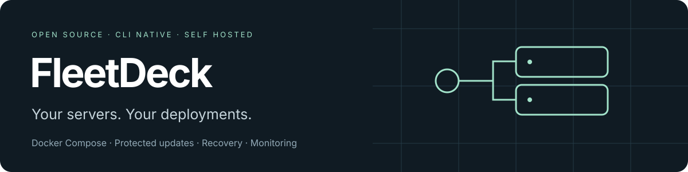
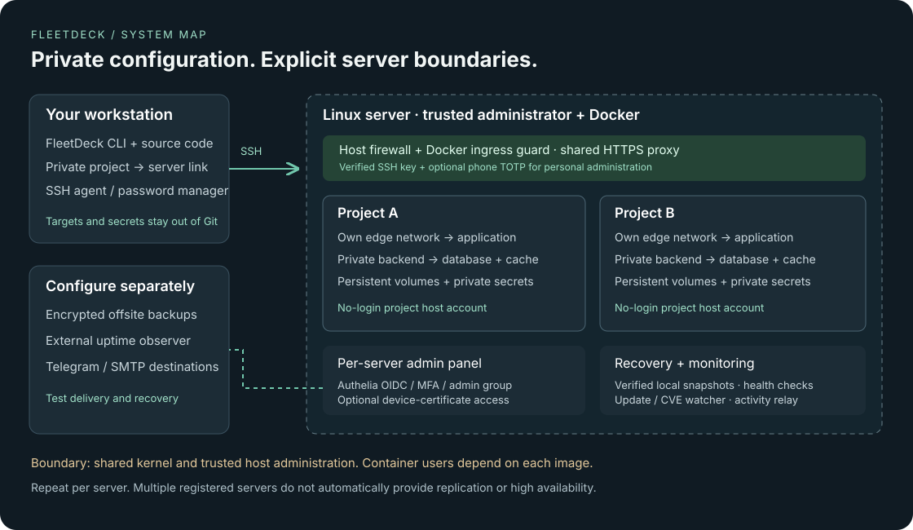

<p align="center"></p>

<p align="center">
  <a href="https://github.com/Artaeon/fleetdeck/actions/workflows/ci.yml"></a>
  <a href="LICENSE"></a>
</p>

# Deploy from your terminal. Keep control of your server.

FleetDeck is an open-source CLI for running Docker Compose applications on your
own Linux servers. Set up a host, link a project on your workstation, and deploy
through SSH with server-side backups and preserved secrets. A per-server admin
panel brings projects, deployment jobs and monitoring into the browser.

**[Get started](INSTALL.md) · [Project deployment](docs/PROJECT_DEPLOY.md) ·
[Security model](docs/SERVER_SECURITY.md) · [Website](https://artaeon.github.io/fleetdeck/)**

```sh
# Once on your workstation, after provisioning a FleetDeck server:
fleetdeck client init
fleetdeck server add production operator@server.example.com
fleetdeck project link ./my-app --server production --name my-app \
  --domain preview.example.com

# Explicitly provide the first private .env if the application needs one:
fleetdeck deploy ./my-app --env-file /private/path/production.env

# Next time: same target, existing server secrets, verified pre-update backup.
cd my-app
fleetdeck deploy .
```

Both client and server need the protected source deployment protocol. Project
links live in private workstation configuration **outside your repository**.
Review generated build/Compose files, configure health checks and test recovery
before directing production traffic. See [the full workflow](docs/PROJECT_DEPLOY.md).

## One host, several projects, explicit boundaries



| Capability | What FleetDeck provides |
| --- | --- |
| Server setup | Docker/Compose, HTTPS proxy, SSH hardening, dedicated administrator, host firewall and Docker forwarding guard. Review existing hosts before migration. |
| Project deployment | Private saved targets, bounded source transfer, per-project locks, preservation of server secrets/data, verified backups before replacement and Compose readiness checks. |
| Recovery | Configuration, supported database dumps, volume archives, integrity verification, restore commands and immutable release jobs. Offsite delivery and restore drills need configuration. |
| Admin panel | Per-server project view, bounded release jobs, monitoring view and server inventory. Authelia OIDC, required factors/admin group and optional device certificates. |
| Monitoring | HTTP/service checks, Prometheus metrics, challenge-aware HTTP results, Telegram/email alerts and durable SSH/activity event relay. |
| Security watcher | Scheduled release/package checks, Trivy scans of running image IDs and runtime-setting findings. Changed alerts only; incomplete checks stay unknown. |
| Workstation setup | Named servers, last observed server version/commit, SSH agent support and interactive SSH TOTP for enrolled hosts. |

FleetDeck uses established tools: **Docker Compose, Traefik, Authelia, Trivy,
Prometheus-compatible metrics and rclone-compatible backup storage**. Uptime Kuma,
Grafana and an external observer can complement it; FleetDeck does not yet
install and synchronize a complete monitoring stack automatically.

## Bring your application

The deployment contract is Docker Compose. Built-in detection and templates help
with common stacks; a working image, explicit storage and health checks are what
make an application deployable.

| Application | Starting point |
| --- | --- |
| Next.js, Node.js, NestJS | Built-in detection/templates; Next.js standalone output and application-specific build variables need review. |
| Python, Go and other backends | Built-in starters where available, or your own Dockerfile and Compose services. |
| Astro, Svelte, static sites | Static builds can be served from the appropriate output directory. SSR needs its matching adapter/runtime. No universal framework smoke-test guarantee. |
| CMS, SaaS, fullstack apps | Compose your application, database and uploads. Verify that CMS's migrations, mail, storage and data restoration work. |
| Workers and internal services | Private Compose services without public ports. The current project-deploy CLI still requires a domain; worker-only onboarding needs manual configuration. |

Profiles: `bare`, `server`, `saas`, `static`, `worker`, `fullstack`.
The SaaS profile includes PostgreSQL, Redis, MinIO and a development mailbox;
production email requires a real SMTP service. Templates are editable starting
points, not a promise that every repository runs unchanged.
[Application coverage and integration limits →](docs/APPLICATION_COVERAGE.md)

## Security is a maintained process

New project host accounts have no login shell and no Docker-group membership.
Generated projects use separate edge/backend networks and runtime restrictions.
The firewall guards Docker ingress as well as host listeners. SSH can require
both an SSH key and a phone authenticator; the browser uses a separately
configured identity provider and required authentication factors.

**The administrator and Docker daemon remain trusted host authorities.** A
per-project host account is different from the UID inside a container. Custom
images can start as root; shared-kernel containers are not a hostile-tenant
boundary. Use separate VMs/hosts for mutually untrusted workloads. A synced
passkey is not proof of binding to one physical device, and mail is not a third
factor simply because it is configured for recovery.

```sh
# Read-only update, image CVE and runtime-setting report on the server:
sudo fleetdeck --config /etc/fleetdeck/config.toml security check
```

Install the [security watcher timer](docs/SECURITY_WATCHER.md) to receive changed
findings through Telegram/email. It never silently upgrades applications.
FleetDeck's own CI runs daily Go vulnerability checks and Dependabot updates;
application dependencies still need their own checks.

## Recovery before confidence

Protected source updates verify a server-side snapshot before replacing files.
Stateful writers stop during backup/build, so this path has a maintenance window.
Existing `.env`, referenced private files and persistent data are preserved.
A failed backup blocks the update. Startup failure retains the snapshot for a
migration-aware recovery decision; automatic database rollback could lose new data.

Local snapshots are not disaster recovery. Configure encrypted offsite backups,
retention, delivery alerts and an external uptime check. Perform a restore drill.
For deployments using prebuilt immutable images and explicit migration jobs, use
[the separate release workflow](docs/RELEASE_JOBS.md).

Multiple named servers are supported. **Automatic HA clustering, replicated
databases, coordinated failover and a complete cross-server control plane are
not yet implemented.** Each server runs its own FleetDeck instance and panel.

## Documentation

| Start / operate | Secure / recover |
| --- | --- |
| [Installation](INSTALL.md) | [Host firewall and isolation](docs/SERVER_SECURITY.md) |
| [Workstation and server inventory](docs/LOCAL_CLIENT.md) | [SSH MFA and recovery](docs/SSH_ACCESS.md) |
| [Protected project deployment](docs/PROJECT_DEPLOY.md) | [Authelia and passkeys](docs/AUTHELIA.md) |
| [Application coverage](docs/APPLICATION_COVERAGE.md) | [Admin access](docs/ADMIN_ACCESS.md) |
| [Notifications and monitoring](docs/NOTIFICATIONS.md) | [Update / vulnerability watcher](docs/SECURITY_WATCHER.md) |
| [SMTP configuration](docs/SMTP.md) | [Migration and restore runbook](docs/EXISTING_SERVER_MIGRATION.md) |
| [Cloudflare origins](docs/CLOUDFLARE.md) | [Release jobs](docs/RELEASE_JOBS.md) |
| [Public repository boundary](docs/PUBLIC_REPOSITORY_BOUNDARY.md) | [Release verification](docs/RELEASE_SECURITY.md) |

Use `fleetdeck --help` and `fleetdeck <command> --help` for the current command
reference. Keep server addresses, personal identities, credential exports and
operational runbooks in private storage. Public examples use placeholder data.

## Develop and contribute

Use the Go toolchain declared in `go.mod`, a C compiler for SQLite, and Docker
with Compose/Buildx for integration tests. On macOS, Colima can provide the local
Docker environment; it is a test environment, not a Linux host-hardening target.

```sh
make build
go test ./...
go test -race ./...
go vet ./...
```

CI also exercises real Docker deployment/recovery, firewall packet handling,
SSH/MFA, Authelia login, release packaging and secret scanning. Integration tests
use disposable fixtures; read each script's requirements before running it.

Contributions that make deployments easier to understand, verify and recover are
welcome. Keep changes focused, include meaningful tests and document operational
limits. Follow [the security policy](SECURITY.md) for vulnerability reports.
FleetDeck is available under the [MIT license](LICENSE).
