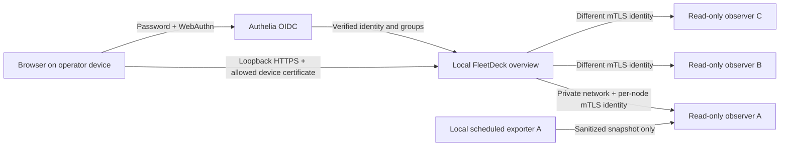

# A private central server overview

FleetDeck's optional **local fleet mode** displays explicitly enrolled servers in
one read-only dashboard on an operator workstation. It requires loopback HTTPS,
an authorized browser device certificate, and Authelia password + WebAuthn login.
It cannot bind to a public or LAN interface. Enable it explicitly with
`[fleet] enabled = true` in a separate private configuration.

This mode has no deploy, shell, webhook, Docker, configuration-edit or local
administration API. Existing per-server dashboards remain separate. Adding CLI
destinations with `server add` never enrolls an observer or contacts it implicitly.
The central process does not open the workstation's server registry or probe its
Docker daemon. Collection starts only for nodes the signed-in user may view.

## Architecture and permissions



| Grant | What a user can see/do |
| --- | --- |
| OIDC `admin_group` | Permits login to this particular dashboard; does not grant every node. Use a dedicated group such as `fleet-observers`. |
| Node `view_groups` | Node label/group, observation time, version, project count, aggregate monitoring and security counts. |
| Node `detail_groups` | The summary plus project names, recorded status and last backup-record timestamps. |
| No matching node grant | Node is absent from the overview; detail requests return the same 404 as an unknown node. No collection request is sent for that user. |

Groups are taken from the authenticated OIDC UserInfo response after subject
verification. Browser identity headers, bearer tokens and UI controls cannot grant
access. Matching is exact and case-sensitive. Detail grants imply summary access.
There is no implicit superuser grant. The operator edits enrollment/permissions in
the local file, outside Git, and restarts the dashboard to apply/revoke them.

Sessions expire after at most 15 minutes or ID-token expiry, whichever is sooner.
Provider group changes take effect at the next login; restart the dashboard for
immediate revocation of all local sessions. Logout revokes that session. The
existing per-server dashboard still uses its existing administrator policy; these
new node grants do not create fine-grained roles in its local project API.

## 1. Establish private connectivity and certificates

All addresses below are examples, not live infrastructure. Do this only on hosts
you explicitly intend to enroll, after the [existing-server checks](SERVER_SETUP.md).

Use an existing private management network or an explicitly configured
[WireGuard tunnel](https://www.wireguard.com/quickstart/). This release does not
install VPNs or change firewall rules. Bind each observer to its management IP;
allow its TCP port only from the operator device. Keep database ports private.
Review VPN routing separately from FleetDeck's dedicated Docker firewall policy.

Use an established private PKI, for example open-source
[step-ca](https://smallstep.com/docs/step-ca/), to issue the following X.509
certificates. FleetDeck uses Go's standard TLS implementation, not custom crypto.

* Each observer: a distinct server key/certificate with `serverAuth` and a SAN
  matching its configured HTTPS hostname or IP.
* Workstation to each observer: a **different** key/certificate with `clientAuth`.
  Never reuse a browser credential, SSH key, OIDC secret or all-powerful host token.
* Local dashboard: a server certificate with SAN `localhost` (and the loopback IP
  if used), trusted by the local browser.
* Browser: a separate `clientAuth` device certificate installed in the intended
  device's certificate store. Explicitly allow its public leaf certificate on the
  dashboard. Protect the private key; prefer hardware-backed storage when available.

Keep CA signing keys offline or on a separately administered CA. Store recovery
material in your password manager; FleetDeck does not automatically synchronize
1Password or provision PKI. Private PEM keys must be regular files with mode
`0600` or `0400`. Do not commit certificates with private identities, private keys,
real endpoints or local configuration.

The collector verifies CA chain, expiry, server hostname **and the enrolled leaf
certificate**. The observer verifies the client chain and exact allowed leaf.
TLS 1.3 is required. A sibling certificate from the same CA is insufficient.
Destinations are operator-pinned private/loopback IP:port values: no DNS lookup,
environment proxy, HTTP redirect or URL supplied by the browser is used.
Carrier-grade NAT ranges are not accepted by this initial address policy; use an
RFC1918/ULA management address or a reviewed local tunnel.

For hosts without a private management network, the
[restricted SSH transport guide](OBSERVER_SSH_TUNNEL.md) describes a loopback
observer with a separate forwarding-only account. Personal SSH MFA is preserved;
the observer continues to require its independent, per-node mTLS identity.

## 2. Export and serve one node

On the intended Linux node, create a dedicated account without a login shell,
sudo or Docker membership. The sample service names that account
`fleetdeck-observer`. Create `/var/lib/fleetdeck-observer` owned by
`root:fleetdeck-observer`, mode `0750`. Install its TLS files under a private
`/etc/fleetdeck/observer` directory readable only by that account. The account
needs read access to its own key, certificates and sanitized snapshot only.

Generate the snapshot as a trusted local operator:

```sh
sudo fleetdeck --config /etc/fleetdeck/config.toml fleet snapshot \
  --node-id node-a --output /var/lib/fleetdeck-observer/snapshot.json \
  --security-state /var/lib/fleetdeck-security/state.json
```

Supply the actual existing watcher-state path; omitting it leaves security
unknown. Monitoring uses the existing `[monitoring] state_file`. Neither command
runs vulnerability scans or contacts applications. Registry access is read-only;
an absent registry is an error. Exports omit domains, credentials, filesystem
paths, raw errors/logs, container IDs and image IDs. Review project names as
potentially private metadata before granting detail access.

Current FleetDeck writers retain SQLite's private `-wal` and `-shm` sidecars so
exports also work on a read-only filesystem after the last writer closes. After
upgrading an older installation, run an ordinary registry command once as the
operator before starting the protected exporter. Keep those sidecars private and
do not manually delete them or copy only the main database during writes. See
[SQLite's WAL guidance](https://sqlite.org/wal.html). The observer's read-only
connection neither migrates the registry nor checkpoints it on close.

The exporter writes mode `0640` atomically. Run it with primary group
`fleetdeck-observer`, as in the example service, so the observer can read it.
Schedule it every minute. See the reviewable service/timer examples in
[`deploy/fleet`](../deploy/fleet/). They are not installed automatically. Adjust
paths, node identity and the observer address before installing; test the command
and file permissions before enabling the timer.

The observer command is:

```sh
fleetdeck fleet agent --node-id node-a \
  --snapshot /var/lib/fleetdeck-observer/snapshot.json --addr 10.77.0.11:9443 \
  --tls-cert /etc/fleetdeck/observer/server.pem \
  --tls-key /etc/fleetdeck/observer/server-key.pem \
  --client-ca /etc/fleetdeck/observer/management-ca.pem \
  --allow-client-cert /etc/fleetdeck/observer/workstation-node-a.pem
```

Run that command as `fleetdeck-observer`, not root. It does not load the host
FleetDeck configuration. Only `GET /v1/snapshot` exists; other paths, methods,
query parameters and unverified clients are refused. No general dashboard/API
token is accepted. Keep this port off the public internet even though mTLS is
mandatory. Do not expose it through a TLS-terminating CDN/proxy that loses the
end-to-end client certificate.

## 3. Create the local dashboard configuration

Register a **new** Authelia OIDC client for
`https://localhost:8420/auth/callback`; preserve existing clients. The workstation
browser follows the callback locally, so the identity provider needs no inbound
connection to the workstation. On the workstation, use the existing helper:

```sh
fleetdeck dashboard setup-authelia --issuer https://auth.example.invalid \
  --public-url https://localhost:8420 --admin-group fleet-observers \
  --output /private/operator/fleet-login
```

Merge the generated client registration into the provider deliberately using the
[Authelia guide](AUTHELIA.md). Require password + WebAuthn and test recovery. This
helper does not install the provider or modify it remotely. Copy the generated
`[server.oidc]` settings into a private workstation TOML and add:

```toml
[audit]
enabled = true
log_path = "/private/operator/fleet-audit.log"

[fleet]
enabled = true

[[fleet.servers]]
id = "node-a"
label = "Web applications"
group = "production"
url = "https://node-a.management.example:9443"
address = "10.77.0.11:9443"
ca_file = "/private/operator/pki/node-a-ca.pem"
server_cert_file = "/private/operator/pki/node-a-server.pem"
client_cert_file = "/private/operator/pki/workstation-node-a.pem"
client_key_file = "/private/operator/pki/workstation-node-a-key.pem"
view_groups = ["fleet-production-viewers"]
detail_groups = ["fleet-production-operators"]
```

Use absolute paths for your own device. The URL hostname must match the server
certificate SAN; its port must match `address`. No DNS record is required by the
collector because the connection address is pinned. Public certificates/CA roots
may be readable, but only the operator may modify enrollment, pins and keys.
Keep the configuration directory private and its TOML mode `0600`.

Start explicitly, using your device's private paths:

```sh
fleetdeck --config /private/operator/fleet-overview.toml dashboard \
  --addr 127.0.0.1:8420 \
  --tls-cert /private/operator/pki/localhost.pem \
  --tls-key /private/operator/pki/localhost-key.pem \
  --client-ca /private/operator/pki/device-ca.pem \
  --allow-client-cert /private/operator/pki/browser-device.pem
```

Open `https://localhost:8420`, select the allowed browser certificate, and sign in
through Authelia. There is no public tunnel or sharing mode. Do not reverse-proxy
or port-forward this listener to other machines. Stopping the local process makes
the overview unavailable; workloads, on-node monitoring and alert delivery keep
running independently. Global visibility is not continuously collected while the
workstation is off.

## 4. Add three servers and group them

Repeat the observer setup and independent credential issuance for `node-b` and
`node-c`. Add another `[[fleet.servers]]` block for each, with its own URL, pinned
address, server leaf and **unique workstation client key**. Use the same `group`
value to present them together. Give a team only the view/detail groups it needs.
The browser shows only permitted nodes and permitted group names.

This creates a **management group**, not an HA cluster. Deploy whole projects to
individual registered targets using [private project links](PROJECT_DEPLOY.md).
Splitting an application's frontend, worker and database across hosts requires
explicit private networking and application configuration. FleetDeck does not
schedule components, move volumes, replicate data or recover them on another node.

For an actual cluster, follow [the separate cluster design guide](CLUSTERS.md).
There is no `fleetdeck cluster create` command in this release.

## Interpretation, revocation and recovery

* Exports older than three minutes, future timestamps, wrong node IDs or schema,
  oversized replies, transport failures and invalid JSON become unavailable.
  Previously received success is not retained as current after a failed refresh.
* Monitoring and security timestamps remain separate. Old scan evidence is
  unknown after 26 hours; an unknown release/host/image check stays visible.
  Findings may overlap across images. A fresh export is not a fresh scan.
* Registry status is recorded state, not a Docker health probe. A backup timestamp
  is a database record, not a verified file, offsite copy or restoration test.
* Collection has bounded responses/timeouts, at most eight concurrent requests,
  a 30-second per-node cache and at most 64 nodes. Larger fleets can have unknown
  results if the overall eight-second request window expires; refresh again.
* Audit records use a hash of the authenticated subject, node identifier and
  outcome. Protect and retain local audit logs; they are not a remote tamper-proof
  audit service. No provider token, raw transport error or secret is logged.
* Remove a node client leaf from the observer allowlist and restart the observer
  to revoke that workstation's access. Remove the browser leaf and restart the
  local dashboard to revoke its browser sessions. Rotate a server certificate by
  updating its enrolled leaf on the workstation and restarting both endpoints.
  Restarting closes active connections; TLS session resumption is disabled.
  CA revocation alone is not checked via CRL/OCSP here: remove pins/allowlists.

The layers are private reachability, TLS peer authentication, browser device
authorization, fresh password/passkey login, server-side group checks and the
absence of write capabilities. These are complementary controls, not five
independent human authentication factors. A synced passkey or exportable device
key is not proof of one physical device. Malware/root on that workstation can
still use its privileges; another local user may reach loopback but must also
possess the authorized device key and login. FleetDeck does not claim OS isolation
inside one user account, verified hardware binding or immunity to vulnerabilities.
The workstation process holds read credentials for all enrolled nodes: a full
compromise of that process/device can expose their exported metadata even when
individual browser users have narrower grants. Those credentials still cannot
invoke node administration. A compromised node can falsify its own observations;
the overview is not remote attestation or an independent security audit.

Before enrollment, run the local tests and verify with synthetic identities:
missing/wrong/expired certificates, wrong groups, hidden nodes, stale exports,
offline nodes, logout/restart revocation and provider outage. Test the actual
browser certificate + passkey flow on the intended workstation before relying on
it. This feature does not enable or contact any server until configured and used.
