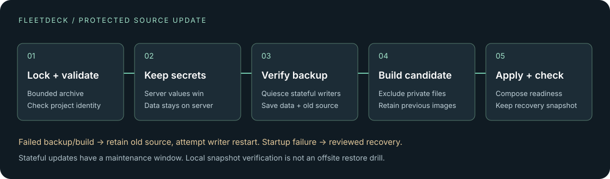

# Private project targets and protected source deployments

This workflow is for a trusted operator deploying a reviewed Docker Compose
application to a Linux FleetDeck server. Use it from an interactive workstation,
including hosts with enrolled SSH key + phone TOTP authentication. Both client
and server must advertise source deployment protocol `1`; an older server is
refused rather than falling back to an unprotected upload.

## Link once, deploy again

```sh
fleetdeck client init
fleetdeck server add production operator@server.example.com
fleetdeck project link ./my-app --server production --name my-app \
  --domain preview.example.com --profile saas
fleetdeck project show ./my-app
fleetdeck deploy ./my-app --env-file /private/path/production.env
# Subsequent updates preserve the server's existing secrets:
fleetdeck deploy ./my-app
```

`--env-file` is an explicit first-deployment seed for `.env`. Supply it from a
private password-manager export, then remove that export when finished. FleetDeck
does not read 1Password vaults automatically. With SSH MFA enabled, prefix commands
with `FLEETDECK_SSH_MFA=totp`; enter the phone code at the hidden terminal prompt.

The link is a private `0600` TOML file under the OS user configuration directory,
in `fleetdeck/projects/`, keyed to the canonical source-directory path. It stores
the named server, project name, domain, profile and server config path. It is
outside the source repository. Moving to another directory requires linking
again. `--replace` deliberately changes a link. Explicit deploy flags override
its values; an untrusted repository cannot select a target through its own file.
The server inventory retains the last observed FleetDeck version and commit.

Review generated Dockerfile and Compose files before deploying. Generation is a
starting point, not application validation. Explicit secrets, production mail,
health checks, volumes and application migrations remain project configuration.
For a backend-only service, keep its ports private; this CLI still requires a
project domain and does not yet provide a dedicated worker-only wizard.

## What happens on the server



1. Acquire a per-project lock. Validate the bounded source archive and the
   existing project identity. New projects receive a no-login host account,
   private group and no Docker-group membership.
2. Preserve existing `.env`, Compose `env_file`, secret/config file references
   and writable bind mounts. Exclude known secret filenames, VCS directories,
   caches and persistent bind data from the upload. An explicit local `.env`
   never replaces an existing server `.env`.
3. Validate Compose and build paths. Refuse privileged containers, host network /
   PID / IPC namespaces, additional capabilities, devices, unconfined runtime
   settings and bind mounts outside the project. These checks do not sandbox
   malicious Dockerfiles or trusted administrator actions.
4. Before an update, stop application writers when persistent mounts exist.
   Keep native PostgreSQL/MySQL/MariaDB services available for logical dumps;
   stop other writers for consistent file copies. Create a server-side snapshot
   of configuration, supported databases, persistent volumes and replaced source
   files, then verify its manifest and checksums. A failed backup stops the update.
5. Retain the old container images under backup-specific local tags. Build the
   candidate before replacing source files. Docker Buildx / BuildKit is required;
   generated Dockerfile-specific ignore rules exclude preserved private files
   even after user negation rules. Never pass production secrets as build args
   or write them into source: filename exclusions cannot discover arbitrary secrets.
6. Replace regular source files, prepare the project edge network, then start
   without another pull/build and wait for Compose readiness. Without an actual
   health check, Compose readiness establishes only that the service is running.

A stateful update has a maintenance window while writers are stopped, including
backup and build time. This workflow does not promise zero downtime. Backup/build
failure retains old source and attempts to restart stopped writers; any failed
restart is reported for operator recovery. A startup failure retains the snapshot
and marks the project failed. Application migrations can change data, so FleetDeck
does not blindly restore a database on a failed startup.

## Recovery and backup boundaries

The command prints the verified backup ID. Inspect it on the server:

```sh
sudo fleetdeck --config /etc/fleetdeck/config.toml backup list my-app
sudo fleetdeck --config /etc/fleetdeck/config.toml backup verify my-app BACKUP_ID
```

Test a full restoration on an isolated copy before relying on it in production.
`backup restore` can overwrite newer data. Decide whether configuration-only
recovery or full data restoration is appropriate, and stop writes before full
restoration. Follow [the migration and recovery runbook](EXISTING_SERVER_MIGRATION.md).
A source snapshot also stores `runtime-images.json`, a Compose override pointing
to retained local images. After a reviewed restore with `--no-start`, start with
both the restored Compose file and that override, `--no-build --pull never`.
The normal restore command does not automatically select this override. Preserve
these images until their recovery window has expired; removing Docker images or
losing the host can remove this local recovery option.

Snapshots here are private, verified **local** backups. They do not automatically
provide offsite delivery, encryption, disaster recovery or a retention schedule.
Configure and test those separately. [Immutable release jobs](RELEASE_JOBS.md)
have a separate, stricter release/snapshot contract. Both paths need a database
migration plan and a real restore drill.

## Deliberate constraints

- One Compose file, no automatic override files, `include` or `extends`.
- Compose `name`, if present, must equal the linked project name. No `COMPOSE_*`
  orchestration overrides in the process environment or project `.env`.
- Literal project-relative private paths; no symlinks or anonymous volumes.
- First deployment can seed only root `.env`; provision other private file
  references on the server explicitly. Existing private files are never rotated
  implicitly. Rotate them through a separate reviewed operation.
- Source files absent from the next upload are retained. Remove obsolete files
  explicitly after reviewing their purpose; use immutable images/releases when
  an exact replacement filesystem is required.
- Basic source strategy only: no `--fresh`, remote shell hooks, automatic client
  rollback or remote `--migrate`. Use reviewed release jobs for migration steps.
- Custom CMS, external databases, remote storage, shared volumes and application
  consistency require their own recovery procedure. A checksum is not a restore test.

The Docker tests exercise an initial seed, preservation of server secrets during
an update, a real PostgreSQL dump, a persistent volume, source/image recovery and
refusal when the database cannot be backed up. They use disposable synthetic data.
